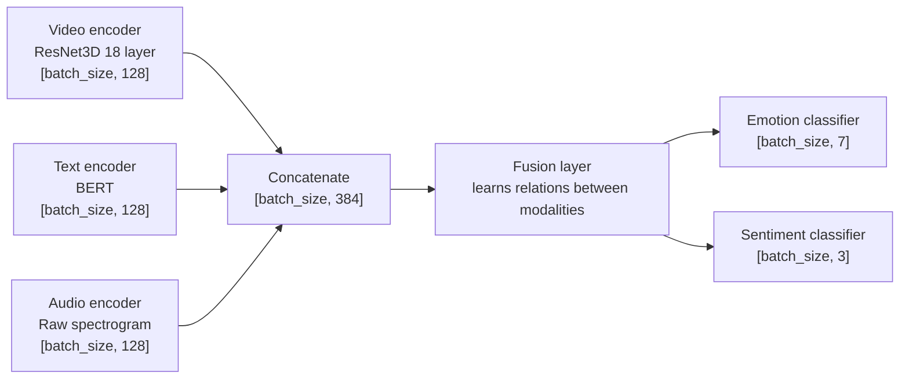
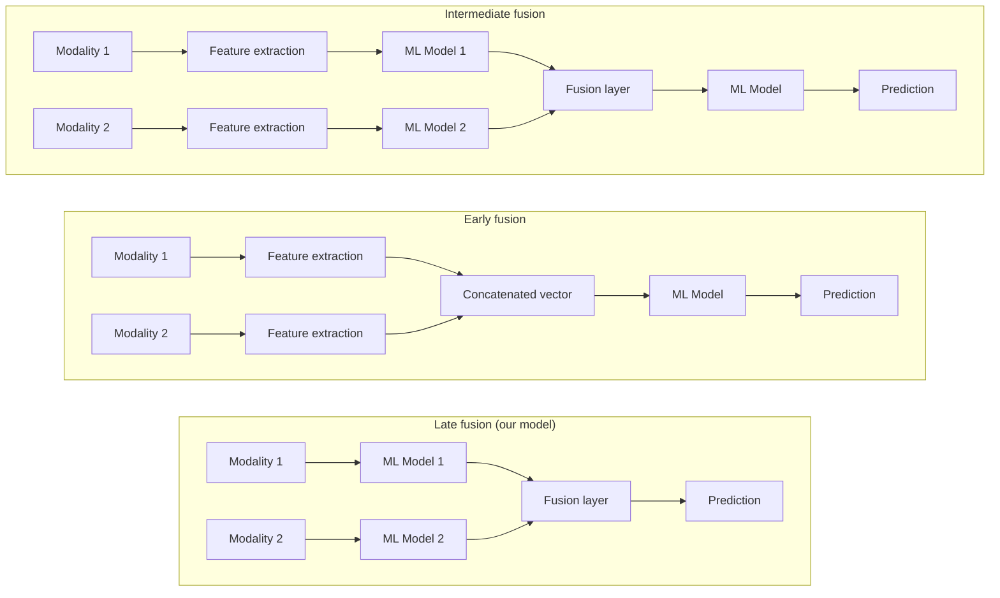
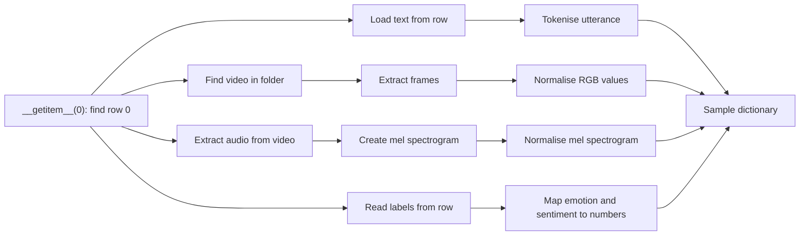
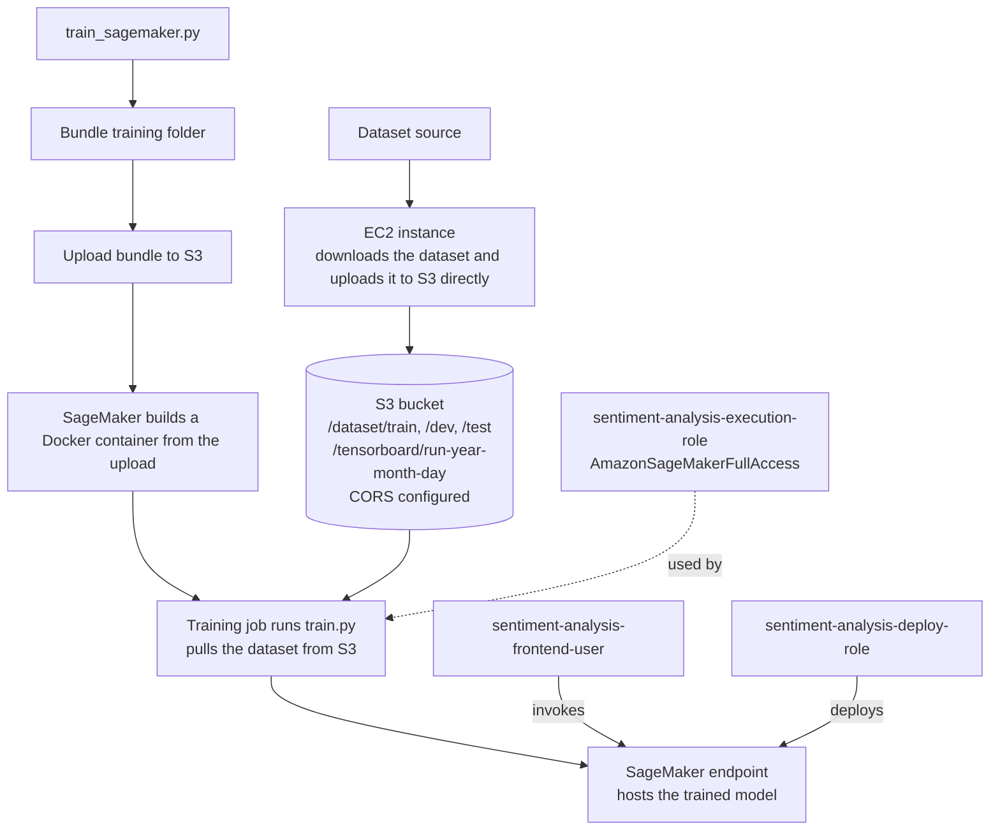
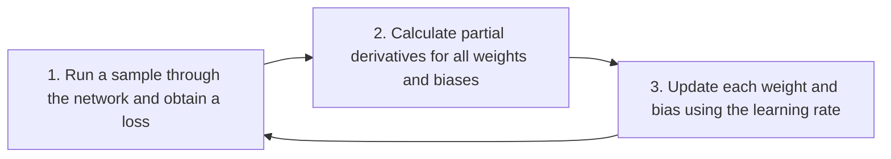

# Multimodal Emotion Recognition

A model that takes a short video clip and predicts both the **emotion** and the **sentiment** of the speaker, using the video frames, the transcript and the audio together.

- **Dataset:** [MELD](https://affective-meld.github.io/) (Multimodal EmotionLines Dataset), built from the TV series *Friends*. Each sample is one utterance with its video, transcript text and audio.
- **Task:** video in, model, then a sentiment (negative, neutral, positive) and an emotion (anger, disgust, fear, joy, neutral, sadness, surprise) out.
- **Use case:** analysing videos in many situations, for example videos submitted in feedback forms.
- **Approach:** late fusion of three encoders (video, text, audio), trained on AWS SageMaker.

## Contents

1. [Model architecture](#model-architecture)
2. [Fusion strategies](#fusion-strategies)
3. [Project plan](#project-plan)
4. [Dataset class](#dataset-class)
5. [Encoders, fusion layer and classifiers](#encoders-fusion-layer-and-classifiers)
6. [Training setup](#training-setup)
7. [AWS setup](#aws-setup)
8. [Background theory](#background-theory)

## Model architecture

Three encoders each turn one modality into a 128-value vector. The vectors are concatenated, a fusion layer learns the relations between modalities, and two task-specific heads make separate predictions.



| Output | Shape | Classes |
| --- | --- | --- |
| Emotion | `[batch_size, 7]` | anger, disgust, fear, joy, neutral, sadness, surprise |
| Sentiment | `[batch_size, 3]` | negative, neutral, positive |

## Fusion strategies

We use **late fusion** because it is the simplest of the three ways to combine modalities.



| | Late fusion (ours) | Early fusion | Intermediate fusion |
| --- | --- | --- | --- |
| How it works | Each modality has its own ML model; a fusion layer combines the outputs | Features are extracted manually (RGB, motion vectors, object detection, etc.), concatenated, and fed to one ML model | Per-modality feature extraction and models, then a fusion layer feeding another ML model |
| Advantages | Simple, because feature extraction happens implicitly in the models; more robust to missing data | One big model, so more efficient | Benefits of both; more flexible |
| Drawbacks | More parameters, so slower; early cross-modal interactions are missed | More sensitive to missing data (for example missing audio), because raw data goes straight into the model | Most complex; more components to tune; needs even more computation |

Analogy for late fusion: watching a movie with a friend in different rooms, then comparing opinions. You miss experiencing and discussing it together in real time.

## Project plan

1. Download the dataset
2. Dataset class (PyTorch)
3. Encoders
4. Fusion
5. Training
6. Evaluation
7. Deployment

## Dataset class

The dataset class lets us batch-load preprocessed samples. It takes the path of the CSV file (columns such as `Sr No.`, `Utterance`, `Speaker`, `Emotion`, `Sentiment`) and the path of the folder with the video files (`video1.mp4`, `video2.mp4`, ...). It stores the label mappings:

```python
self.sentiment_map = {'negative': 0, 'neutral': 1, 'positive': 2}
self.emotion_map = {'anger': 0, 'disgust': 1, 'fear': 2, 'joy': 3,
                    'neutral': 4, 'sadness': 5, 'surprise': 6}
```

- `__len__` returns the number of rows, so `len(my_dataset)` works.
- `__getitem__` makes `my_dataset[0]` work: it finds row 0 and builds one sample.



The returned sample is a dictionary:

```python
{
    "text": ...,
    "video_frames": ...,
    "audio_features": ...,
    "emotion_label": "sadness",
    "sentiment_label": "negative",
}
```

- **Why normalise RGB channels:** standard activation functions work better with normalised values.
- **Why mel spectrograms:** they work well with convolutional neural networks and are more compact than the raw waveform, so they are more efficient.

## Encoders, fusion layer and classifiers

Layers used:

| Layer | Kind | What it does |
| --- | --- | --- |
| Linear | Trainable | Fully connected layer; used for classification |
| Conv1d | Trainable | Learns patterns on sequential data (e.g. audio) |
| ReLU | Functional | Adds non-linearity (`[-2, -1, 0, 1, 2]` becomes `[0, 0, 0, 1, 2]`) |
| Dropout | Functional | Prevents overfitting by randomly turning off neurons |
| MaxPool1d | Functional | Keeps only the strongest features (`[1, 2, 3, 4]` becomes `[2, 4]`) |
| AdaptiveAvgPool1d | Functional | Averages a dimension (`[1, 2, 3, 4]` becomes `[2.5]`) |
| BatchNorm1d | Normalisation | Gives normalised values |

| Part | Layers | Purpose |
| --- | --- | --- |
| Video | Format input as `[batch_size, frames, channels, height, width]` and reorder dimensions, then ResNet3D 18 layer (pretrained), Linear (to 128), ReLU, Dropout (0.2) | Process video features and shrink them to 128 values |
| Text | BERT (pretrained) on `input_ids` and `attention_mask`; pooler output (768); projection layer (768 to 128) | BERT understands each word and the pooler output summarises the sentence; the projection makes the summary smaller |
| Audio | Conv1d (64, k=3), BatchNorm1d, ReLU, MaxPool1d, Conv1d (64 to 128, k=3), BatchNorm1d, ReLU, AdaptiveAvgPool1d, Linear (128 to 128), ReLU, Dropout | Detect lower-order features (e.g. pitch up or down), then higher-order ones (e.g. rhythm); MaxPool1d keeps the biggest of every 2 elements; AdaptiveAvgPool1d averages the last dimension to one number per channel |
| Fusion | Concatenate (384), Linear (384 to 256), BatchNorm1d (256), ReLU, Dropout (0.3) | Learn relationships between modalities |
| Classifiers | Linear (256 to 64), ReLU, Dropout (0.2), Linear (64 to 7 for emotion, 64 to 3 for sentiment) | Output the emotion and the sentiment |

## Training setup

| Piece | Choice | What it does |
| --- | --- | --- |
| Optimizer | Adam | Optimizes the model parameters using the gradients from the loss and tweaks the learning rates |
| Loss function | Cross-entropy loss | Like mean squared error, but the standard for classification tasks |
| Learning rate scheduler | ReduceLROnPlateau | Reduces the learning rate to 1/10 if the loss does not improve for 2 epochs, so gradient descent takes smaller steps near the minimum |

## AWS setup



- **EC2 instance:** downloads the dataset and uploads it to the S3 bucket directly, which is fast because of its high internet speed.
- **S3 bucket:** holds `/dataset` with `/train`, `/dev` and `/test` (each with videos and a CSV file) and `/tensorboard/run-year-month-day`. CORS is set up with allowed origins, methods and headers.
- **Training job:** `train_sagemaker.py` bundles the training folder and uploads it to S3. SageMaker builds a Docker container from the upload and `train.py` runs inside it.
- **Endpoint:** hosts the trained model after deployment.
- **TensorBoard:** clone the logs from S3 to a local folder, then run `tensorboard --logdir <folder>`.

| IAM name | Used for |
| --- | --- |
| `sentiment-analysis-execution-role` | Runs the training job; has `AmazonSageMakerFullAccess` |
| `sentiment-analysis-deploy-role` | Deploys the model to the endpoint |
| `sentiment-analysis-frontend-user` | Invokes the endpoint |

## Background theory

### Neurons and activation functions

A neuron multiplies each input by a weight, adds a bias and applies an activation function `f`:

```
y = f(w1 * x1 + w2 * x2 + b)
```

Without activation functions a network would only be a chain of linear functions, which limits how smart it can become. Activation functions add non-linearity.

| Activation | Behaviour |
| --- | --- |
| Sigmoid | Compresses any value into the range [0, 1]; equals 0.5 at input 0 |
| ReLU | Lets only positive values through; negative inputs become 0 |

Worked example: every neuron uses `Sigmoid(w1*x1 + w2*x2 + b)` with all weights 0.5 and biases 0. Inputs 2 and 3 give `Sigmoid(1) = 0.73` and `Sigmoid(1.5) = 0.82`. Each hidden neuron gives `Sigmoid(0.5*0.73 + 0.5*0.82) = 0.68`, and the output neuron gives `Sigmoid(0.5*0.68 + 0.5*0.68) = 0.66`.

### How a network learns

Training lowers the **loss**, a number that says how wrong the predictions are. Mean squared error compares the expected value with the prediction, squares the difference and averages over all samples:

```
MSE = (1/m) * sum_{i=1..m} (Y_i - Y_hat_i)^2
```

The loss depends on every weight and bias. The partial derivative `dL/dw` says how the loss changes as one weight changes:

- **Positive** `dL/dw`: increasing the weight raises the loss, so decrease the weight.
- **Negative** `dL/dw`: increasing the weight lowers the loss, so increase the weight.

The step size is set by the learning rate `alpha`:

```
w = w - alpha * dL/dw
```

A smaller learning rate makes us more certain we do not overshoot, because every tweak can change all the other partial derivatives.



One pass over all samples is an **epoch**. The loss decreases as the model trains, then converges; after that there is no point in training more.

### Underfitting and overfitting

| | Underfitting | Overfitting | Good fit |
| --- | --- | --- | --- |
| Loss curves | Training and validation loss both stay high | Training loss keeps falling, validation loss rises again | Both decrease |
| Causes | Model too simple; not trained enough; learning rate too small (learns too slowly) or too big (overshoots) | Model too complex; not enough data; training too long | |

Regularisation (adding noise or constraints, for example a dropout layer) stops the model from memorising the training data.

### Tensors and encoding

Tensors are multidimensional arrays that hold data: a scalar is 0D, a vector 1D, a matrix 2D, and so on. A video is encoded as a tensor of shape `[frames, channels, height, width]`, where each pixel has Red, Green and Blue values from 0 to 255. Text is tokenised (for example with `BertTokenizer`) and audio is encoded from its waveform. The input layer must match the tensor size of the data going in, and the output layer the tensor size expected out.

### Modalities, from scratch vs transfer learning

A modality is a type of input or output a model can work with. MELD has three (video, text, audio). Giving the model all of them gives it a better chance of understanding the context.

| | Training from scratch | Transfer learning |
| --- | --- | --- |
| Advantages | Full control and optimisation for the task; smaller model | Better initial performance; less data needed; proven architecture |
| Drawbacks | Needs more data and training time; might underperform | Larger model; may not fit the task |

Pre-trained models preserve context. For text, "a bank with money" and "a river bank" are encoded differently. For video, a pre-trained model can tell a hand wave from motion, a smile from facial features and a nod from the sequence, instead of just seeing brightness go up and down.